<div align="center">

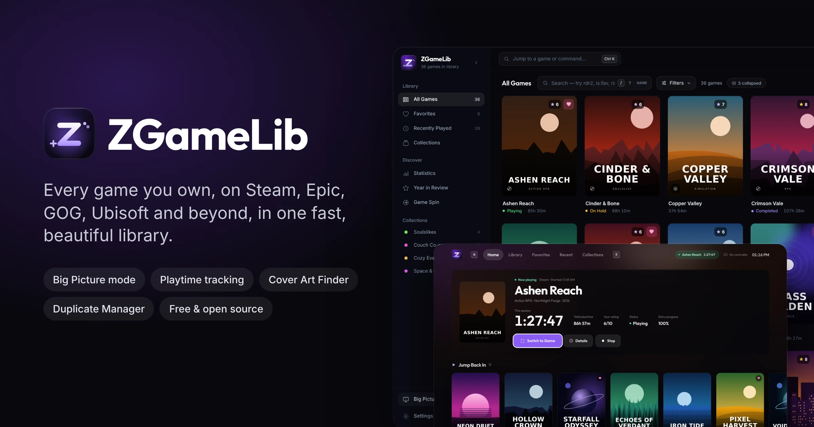

<p><strong>A beautiful, free, open-source game library for Windows.</strong><br/>
Track, organize, rate and launch every game you own — Steam, Epic, GOG, Ubisoft Connect and anything else — from one fast desktop app, with a full-screen Big Picture mode for controllers.</p>

<p>
  <a href="LICENSE"></a>
  
  
  <a href="https://tauri.app"></a>
  
  
</p>

<p>
  <a href="https://zsync.eu/zgamelib/"><strong>🌐 Website</strong></a> &nbsp;·&nbsp;
  <a href="https://github.com/TheHolyOneZ/ZGameLib/releases/latest"><strong>⬇ Download</strong></a> &nbsp;·&nbsp;
  <a href="#screenshots"><strong>📸 Screenshots</strong></a> &nbsp;·&nbsp;
  <a href="CHANGELOG.md"><strong>📝 Changelog</strong></a>
</p>

</div>

---

## What's New in v1.3.0

v1.3.0 is the biggest update yet: a complete redesign, a controller-first **Big Picture mode**, a smarter library and much more reliable playtime tracking.

| Feature | Description |
|---------|-------------|
| **New design** | Every page rebuilt with a cleaner, flatter look inspired by modern game launchers, a new Z controller logo and app icon |
| **Big Picture mode** | Full-screen TV interface for Xbox, PlayStation and Nintendo controllers with a **Now Playing** card, on-screen keyboard and quick menu |
| **Cover Art Finder** | Bulk cover search across Steam, SteamGridDB and IGDB with scene/repack name cleanup and your own regex rules |
| **Duplicate Manager** | Finds the same game across stores, editions, versions and typos, then merges or hides the extras |
| **Smart titles & search** | Clean display names, typo-tolerant search, acronyms (`rdr2`), `/regex/` and filters like `rating>=8 is:fav` |
| **Reliable playtime** | Stop saves your time, sessions survive restarts, sleep and long alt-tabs don't count, failed launches end within seconds |
| **Live session timer** | See how long you've been playing in the sidebar, library hero, game details and Big Picture |
| **Single instance** | Opening ZGameLib again focuses the window that's already running |
| **Performance** | Virtualized grids, no backend work on the UI thread, cached duplicate detection and search — thousands of games stay smooth |

See the full list in the [changelog](CHANGELOG.md).

---

## Screenshots

<div align="center">

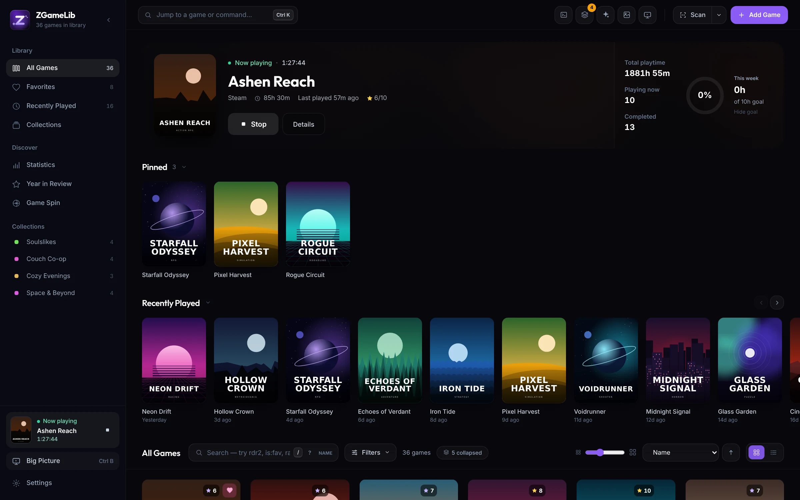
<sub><b>Library</b> — continue-playing hero with live session timer, pinned games, Play Next and Recently Played shelves</sub>

</div>

<table>
<tr>
<td width="50%">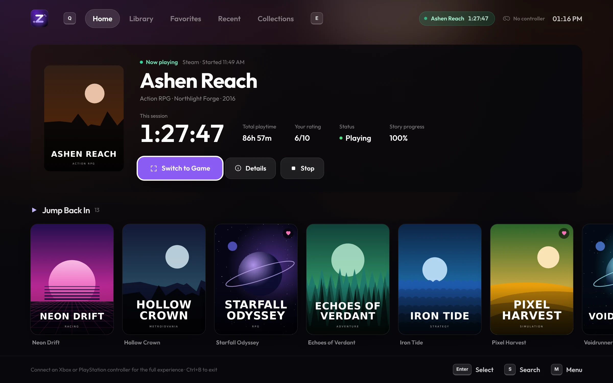<br/><sub><b>Big Picture</b> — controller-first home with the Now Playing card</sub></td>
<td width="50%">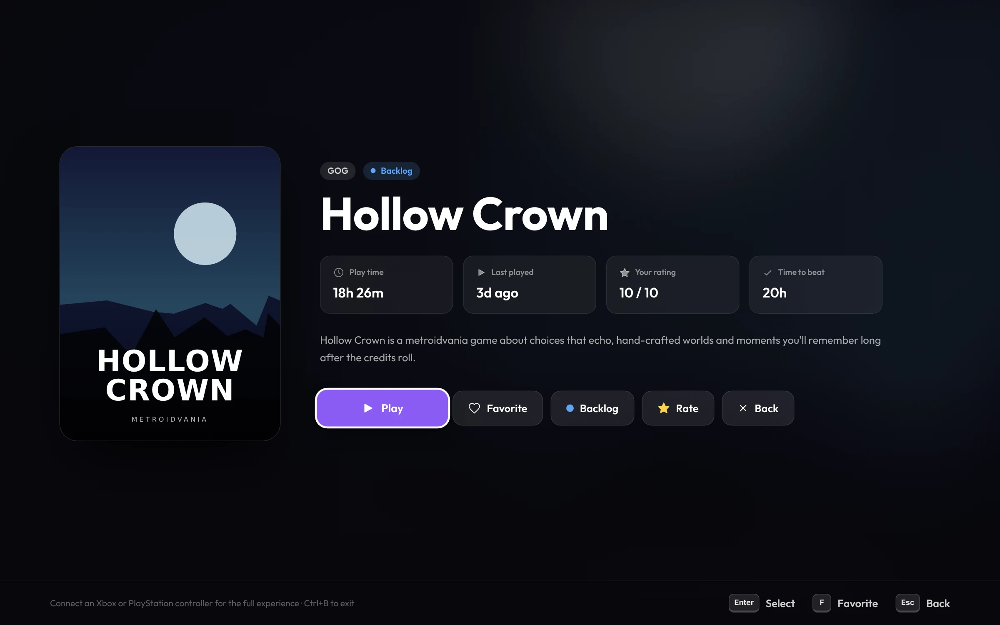<br/><sub><b>Big Picture game page</b> — play, favorite, status and rating from the couch</sub></td>
</tr>
<tr>
<td width="50%">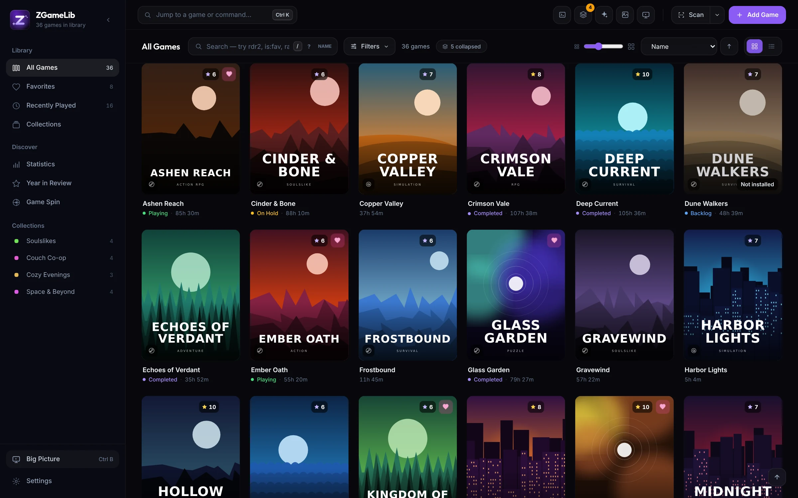<br/><sub><b>All Games</b> — virtualized grid, smart search, filters and card-size slider</sub></td>
<td width="50%">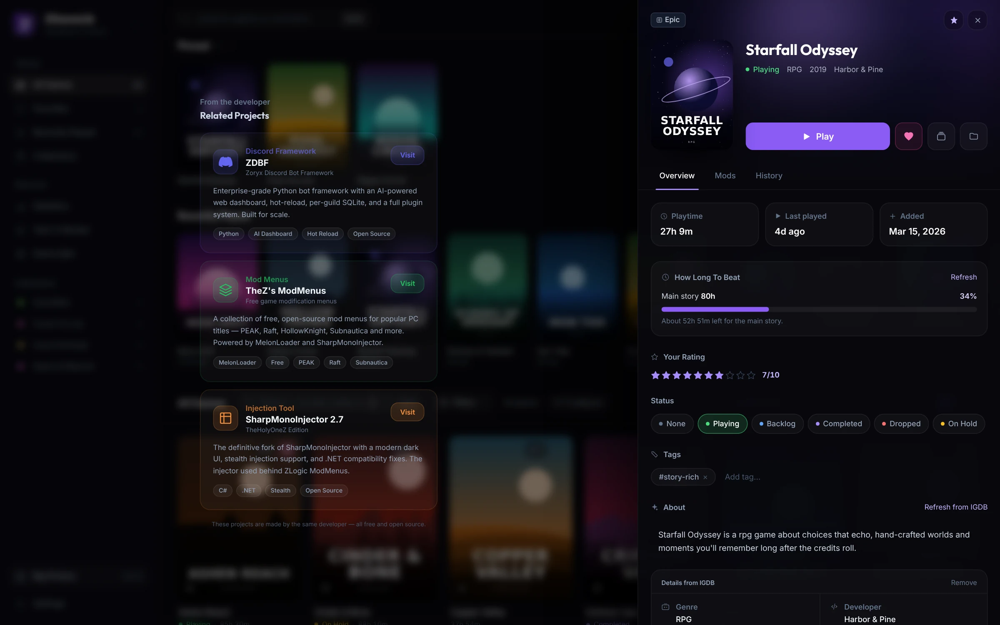<br/><sub><b>Game details</b> — HowLongToBeat progress, rating, status, tags and IGDB info</sub></td>
</tr>
<tr>
<td width="50%">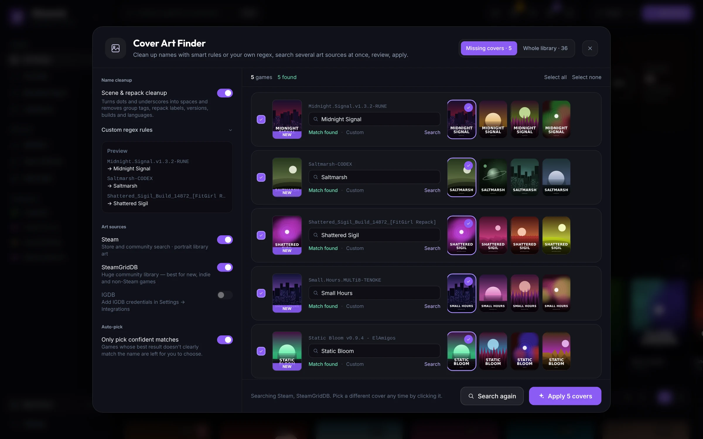<br/><sub><b>Cover Art Finder</b> — cleans scene names and finds art from several sources at once</sub></td>
<td width="50%">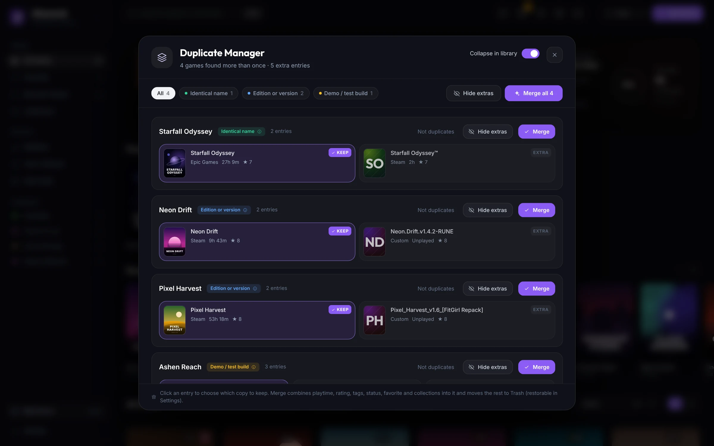<br/><sub><b>Duplicate Manager</b> — merge playtime, ratings and tags into the copy you keep</sub></td>
</tr>
<tr>
<td width="50%">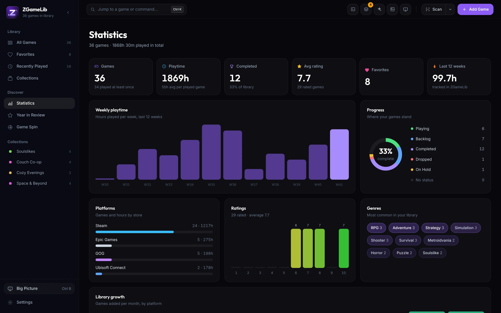<br/><sub><b>Statistics</b> — weekly playtime, progress, platforms, ratings and genres</sub></td>
<td width="50%">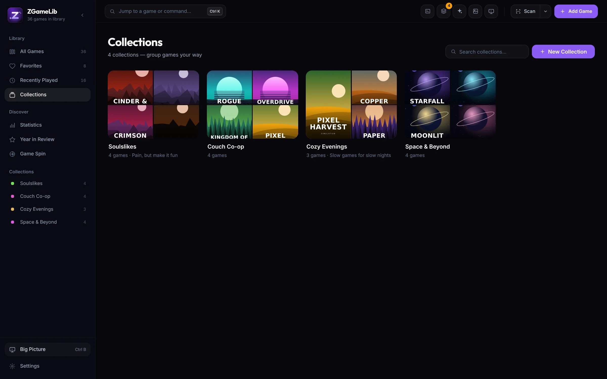<br/><sub><b>Collections</b> — cover mosaics for every group you create</sub></td>
</tr>
<tr>
<td width="50%">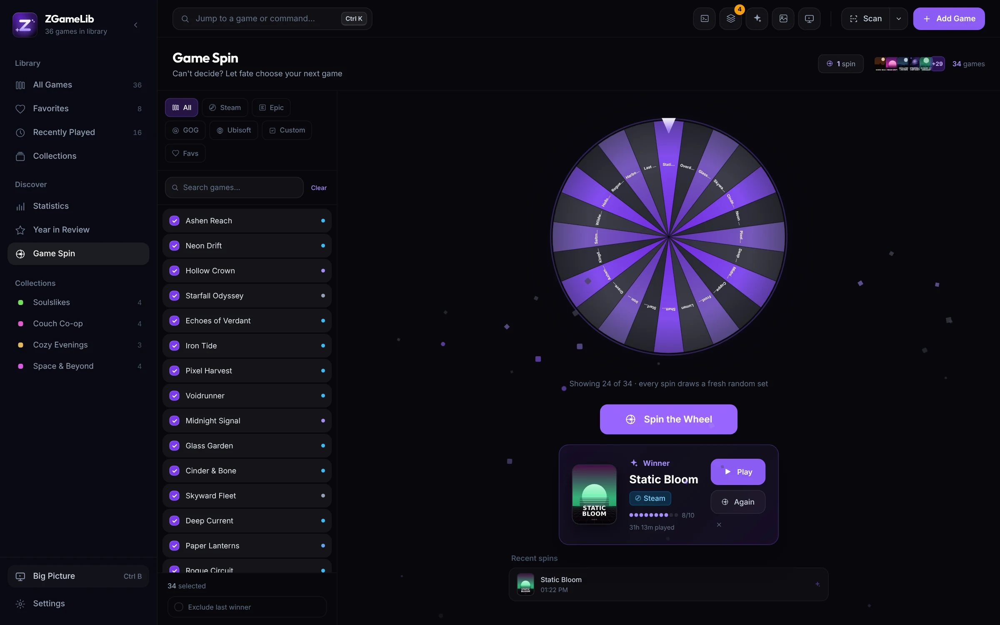<br/><sub><b>Game Spin</b> — can't decide? Let the wheel pick</sub></td>
<td width="50%">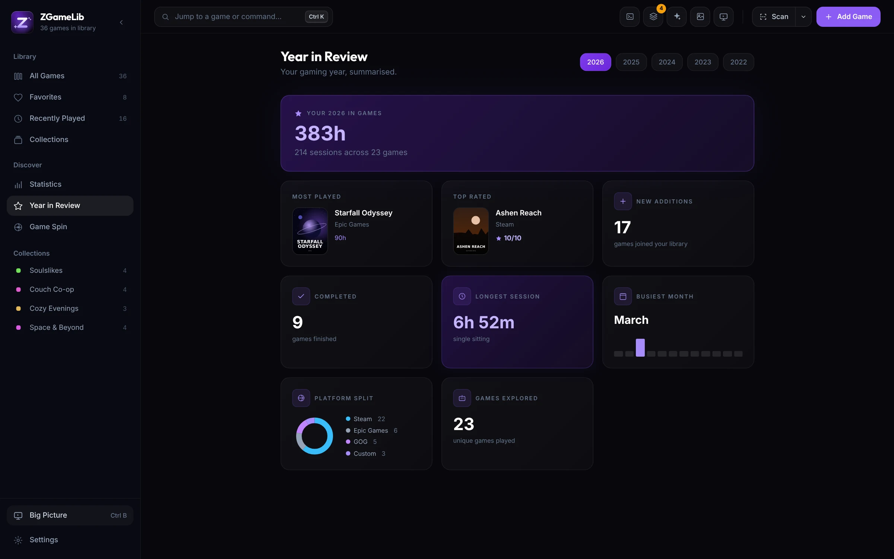<br/><sub><b>Year in Review</b> — your gaming year at a glance</sub></td>
</tr>
<tr>
<td width="50%">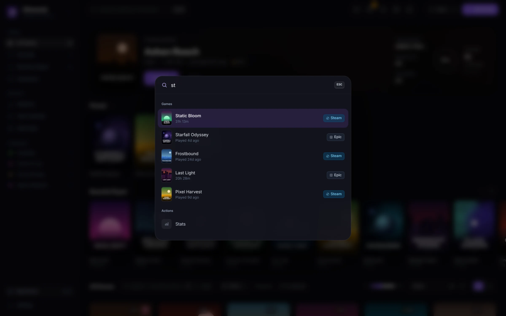<br/><sub><b>Command palette</b> — <kbd>Ctrl</kbd>+<kbd>K</kbd> to jump to any game or action</sub></td>
<td width="50%">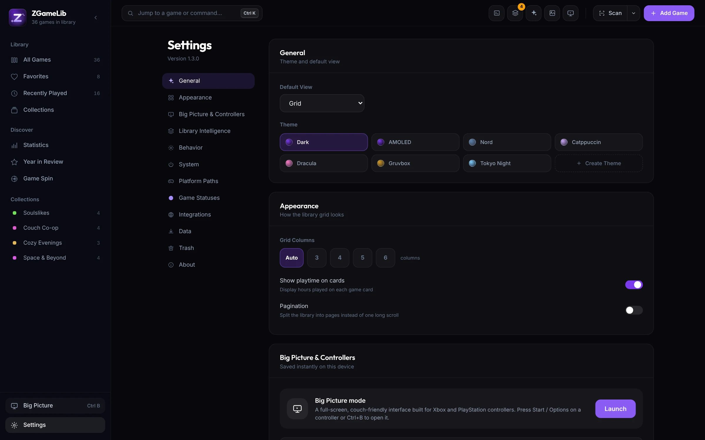<br/><sub><b>Settings</b> — 7 themes plus your own, behavior, integrations and data</sub></td>
</tr>
</table>

<sub>Screenshots use a sample library with made-up games and generated cover art.</sub>

<details>
<summary><strong>Older video preview (v0.3.0)</strong></summary>

<div align="center">

[](https://www.youtube.com/watch?v=rlqUUqAPOxU)

</div>

</details>

---

## Download

Grab the latest installer from **[GitHub Releases](https://github.com/TheHolyOneZ/ZGameLib/releases/latest)**:

| Installer | Format | Notes |
|-----------|--------|-------|
| `ZGameLib_1.3.1_x64_en-US.msi` | `.msi` | **Recommended** — Windows Installer |
| `ZGameLib_1.3.1_x64-setup.exe` | `.exe` | NSIS alternative installer |

> **Windows SmartScreen:** On first launch you may see *"Windows protected your PC"* — click **More info → Run anyway**. This is expected for unsigned indie apps.

---

## Table of Contents

- [What's New in v1.3.0](#whats-new-in-v130)
- [Screenshots](#screenshots)
- [Features](#features)
  - [Big Picture Mode & Controllers](#-big-picture-mode--controllers)
  - [Smart Library](#-smart-library)
  - [Cover Art Finder](#-cover-art-finder)
  - [Onboarding Tour](#-interactive-onboarding-tour)
  - [Library & Scanning](#-library--scanning)
  - [Game Launching & Playtime](#-game-launching--playtime)
  - [Game Detail Panel](#-game-detail-panel)
  - [Mod Loader](#-mod-loader)
  - [Game Spin Wheel](#-game-spin-wheel)
  - [Statistics & Year in Review](#-statistics--year-in-review)
  - [Smart Recommendations](#-smart-play-recommendations)
  - [Themes](#-themes--7-built-in--custom)
  - [System Integration](#-system-integration)
  - [Data & Privacy](#-data--privacy)
- [Keyboard Shortcuts](#keyboard-shortcuts)
- [Tech Stack](#tech-stack)
- [Architecture](#architecture)
- [Database Schema](#database-schema)
- [Scanner Details](#scanner-details)
- [External Integrations](#external-integrations)
- [Project Structure](#project-structure)
- [Building from Source](#building-from-source)
- [License](#license)

---

## Features

### 🎮 Big Picture Mode & Controllers

A full-screen, couch-friendly interface built for TVs and controllers — open it with <kbd>Ctrl</kbd>+<kbd>B</kbd>, the Start / Options button on any connected controller, the sidebar, the top bar or the command palette. It can also start automatically on launch.

<table>
<tr>
<td width="50%" valign="top">

**Navigation**
- **Xbox, PlayStation and Nintendo controllers** — D-pad and left stick navigation, A/B/X/Y actions, LB/RB to switch tabs, LT/RT to jump a page, Start/Options for the quick menu
- **Correct button prompts** — glyphs switch automatically between Xbox letters, PlayStation symbols and keyboard keys, with friendly controller names (DualSense, DualShock 4, Xbox Series)
- Spatial navigation across shelves, grids, chips and dialogs; keyboard and mouse work too
- Rumble on launch, optional interface sounds and optional fullscreen

</td>
<td width="50%" valign="top">

**Views**
- **Home** with Jump Back In, Favorites, Up Next and Recently Added shelves
- **Library** grid with filters (installed, playing, backlog…) and sorting
- Favorites, Recent and Collections tabs
- **Game page** — play, favorite, set status and rating from the couch
- **On-screen keyboard** for search, a quick menu and a launch splash
- **Now Playing card** — while a game runs: live session timer, total playtime, rating, status, story progress, **Switch to Game** (brings the game window back to the front), Details and Stop

</td>
</tr>
</table>

---

### 🧠 Smart Library

- **Duplicate Manager** — finds the same game across stores, editions (GOTY, Deluxe, Definitive…), versions, build numbers, demos/playtests and typos, while keeping sequels apart (Doom 2 ≠ Doom 3, Dark Souls II ≠ III)
  - picks the best copy to keep and **merges** playtime, rating, tags, status, favorite, metadata and collections into it, or just hides the extras
  - "Not duplicates" is remembered; a badge on the top bar shows how many groups were found
- **Collapse duplicates** — on by default, the library, sidebar counts and Big Picture show each game once; uncertain matches are never collapsed automatically
- **Smart titles** — clean display names without ™/®, version and build numbers, store tags like `[GOG]` or `(x64)`, scene and repack tags (`Elden.Ring-CODEX`, `[FitGirl Repack]`) and edition suffixes; original titles stay visible in the game details; can be turned off in Settings
- **Smart search** — typo-tolerant (`wticher` → The Witcher), acronyms (`rdr2`, `gtav`, `ds3`), roman numerals, relevance ranking, `/regex/` patterns and filters:

  | Filter | Example |
  |--------|---------|
  | Platform / store | `platform:steam` |
  | Status | `status:playing` |
  | Rating | `rating>=8` |
  | Playtime | `playtime>10h` |
  | Last played | `played<7d` |
  | Release year | `year>=2020` |
  | Favorites | `is:fav` |
  | Exclude | `-tag:multiplayer` |

  A `?` button shows the syntax and invalid queries are flagged.

---

### 🖼 Cover Art Finder

Bulk cover search for games that are missing art — or for your whole library. Open it from the image button in the top bar, the selection bar, the Filters popover, the command palette or Settings → Data.

- **Several sources at once** — Steam store, Steam community, **SteamGridDB** (add your free API key in Settings → Integrations) and **IGDB** are searched in parallel and ranked by how well the title matches; sequels, soundtracks and DLC rank lower
- **Scene & repack cleanup** — `Midnight.Signal.v1.3.2-RUNE`, `Hades_II_v1.0_[FitGirl Repack]` or `… - ElAmigos` become searchable titles automatically
- **Your own regex rules** — with presets (dots → spaces, drop brackets, drop version, split CamelCase) and a live preview
- Every game's search text is editable; **auto-pick** only uses confident matches, then **Apply** sets all covers in one go
- Covers are downloaded as image files into ZGameLib's local app data folder (`%LOCALAPPDATA%\ZGameLib\covers`); the old file is cleaned up when you replace a cover
- A single-game cover search with the same sources is available from every game's details

---

### 🎬 Interactive Onboarding Tour

The signature 1.0 feature. On first launch, users pick a tour mode — ZGameLib then walks through the entire UI automatically.

**Tour Modes**

| Mode | Steps | Time | Description |
|------|-------|------|-------------|
| Quick Start | 10 | ~2 min | Just the essentials to get started |
| Standard Tour | 23 | ~5 min | All major features at a surface level |
| Deep Dive | 37 | ~10 min | Every tab, every setting, every trick |

**Tour Engine**
- **Animated spotlight overlay** — SVG mask-based cutout with accent glow ring, double pulse rings, and radial gradient highlight; auto-scrolls off-screen targets into view before measuring
- **Live UI demonstrations** — each step actually opens the real UI element: scan dropdown expands and highlights its options, context menu appears on game cards via synthetic right-click, Add Game modal opens, game detail tabs switch automatically, settings page scrolls to each section
- **Full coverage** — dedicated steps for Bulk IGDB, Remove Duplicates, Scan Log, HLTB, IGDB in detail panel, Game Spin, Collections, Stats, Wrapped, and all Settings sections
- **Auto-scan on welcome** — scan runs automatically when the tour starts so games populate while the user watches
- **Chapter system** (Deep Dive) — 37 steps organized into 9 labeled chapters with gradient indicator strip: Start · Getting Games In · The Library · Filtering · Game Cards · Game Detail · Pages · Settings · Finish
- **Cinematic finale** — tour ends with a fly-through purple heart animation and "Made By TheHolyOneZ" credit
- **`afterRender` hook system** — context menu and overlays open after the spotlight is stable, preventing scroll-triggered dismissal
- **Keyboard navigation** — Enter/→ advances, ← goes back, Escape skips
- **Re-triggerable** — "Take the Tour" in Settings → About re-runs any mode at any time
- **Onboarding reset on upgrade** — users upgrading from 0.x automatically receive the tour on first 1.0.0 launch

---

### 📚 Library & Scanning

<table>
<tr>
<td width="50%" valign="top">

**Auto-scanning**
- One-click scan for all four platforms simultaneously
- Per-platform individual scan buttons
- Optional **auto-scan on startup**
- Detects new games and skips existing ones

**Uninstalled Steam Games**
- **Pull Uninstalled** — imports your entire owned Steam library, including games not yet installed, via the Steam Web API
- Uninstalled games display a **"Not Installed"** badge on cards and list rows
- Clicking launch on an uninstalled Steam game opens Steam's **install dialog** (`steam://install/{appId}`) directly
- Scanner **auto-promotes** to installed when the game is detected after download
- **Sidebar filter** — "Not Installed" section shows count and lets you filter to only uninstalled games
- Optional **auto-pull on startup** toggle in Settings → Behavior

**Duplicates & Hidden Games**
- The **Duplicate Manager** (see [Smart Library](#-smart-library)) merges or hides duplicates
- Hide / Unhide any game from the right-click menu — non-destructive
- Toggle show/hide hidden games instantly (`H` shortcut)

**Cover Art Resolution Chain**
1. Steam CDN portrait (`library_600x900.jpg`, then `library_600x900_2x`, then `header.jpg`)
2. GOG product API
3. Best Steam store / community match for the cleaned title (Epic / GOG / Custom)
4. [Cover Art Finder](#-cover-art-finder) — Steam, SteamGridDB and IGDB on demand
5. Generated cover with the game's initials

</td>
<td width="50%" valign="top">

**Views & Sorting**
- **Library home** — "Continue playing" hero with one-click Play/Stop, live session timer, playtime stats and a weekly goal ring; Pinned, Play Next and Recently Played shelves
- **Grid view** — virtualized, so thousands of games scroll smoothly; card-size slider or fixed 3–6 columns
- **Dense list view** — compact rows with all info
- Sort by: name · rating · last played · date added · playtime · **custom order**
- Ascending / descending toggle
- **Drag-and-drop reordering** — select "Custom Order" sort to drag cards into any order; persisted to the database

**Filtering**
- Everything lives in one **Filters popover** with removable "Filtered by" chips in the toolbar
- Filter by platform: All / Steam / Epic / GOG / Ubisoft Connect / Custom
- Filter by status (any custom status)
- Filter by cover art: Has Cover / Missing Cover (sidebar, with counts)
- Favorites-only toggle
- Minimum rating slider
- Tag-based filtering
- Date range filtering (date added from/to)
- **Advanced Filter Builder** — collapsible "Advanced" section; unlimited filter rules with field / operator / value dropdowns; AND / OR logic; fields: platform · status · rating · playtime · tags · date_added · is_favorite · has_cover · not_installed; rules persist across sessions

**Per-Page Search Bar**
- Contextual to each page (Library, Favorites, Recently Played)
- Live result counter
- <kbd>/</kbd> hotkey focuses search from anywhere
- Scope toggle inside input — name only or name + description
- "No games match" empty state with one-click **Clear Filters**
- Scroll-to-top floating button after 400 px of scroll

**Context Menu & Health**
- **Right-click** any game card → Play · Open Folder · Favorite · Pin · Copy Name · View Details · **Collections** (submenu) · **Delete**
- **Exe health badge** — amber warning icon on cards when the executable is missing
- Loading skeleton grid while library loads

**Bulk IGDB Scan**
- Sparkle button (✦) in the Topbar scans every game missing IGDB data
- Live `X/Y` counter badge shows progress while running
- Games flagged after clearing IGDB data are silently skipped

**Command Palette** (`Ctrl+K`)
- Also opened from the "Jump to a game or command…" box in the top bar
- Smart search across your library (duplicates collapsed) with cover thumbnail and platform badge per result; keyboard navigation (↑ ↓ Enter Escape)
- Quick actions for every page plus Big Picture, Cover Art Finder, Duplicate Manager and Add Game

**Batch Multi-Select**
- Checkbox on game cards (visible on hover or when selected)
- **BatchActionBar** slides up from the bottom
- Apply status, set rating, add tag, or add to a Collection — all at once
- Delete all selected games with one click

**Collections**
- Create named collections to group games any way you like
- Grid/list view toggle, search bar, and click-to-edit description per collection
- Right-click a collection to rename or delete it
- Open a collection to browse its games with search and grid/list toggle
- Right-click any game (anywhere) → **Collections submenu** — checkmarks show which collections it belongs to; click to add or remove
- A game can belong to multiple collections simultaneously
- **Remove from Collection** option appears in the right-click menu when browsing a collection

**Weekly Playtime Goal**
- Set a weekly playtime target in the library hero
- Progress ring with the current week's playtime
- "Goal reached!" state; persists across sessions

**Contextual Empty State**
- When library is empty and onboarding is complete: three action cards (Scan for Games, Add Manually, Browse Steam)
- First-run users see the original illustration + "Take the Tour" CTA

</td>
</tr>
</table>

---

### 🚀 Game Launching & Playtime

<table>
<tr>
<td width="33%" valign="top">

**🟦 Steam**
- Launches via `steam://run/{appId}`
- Full Steam Overlay support
- Process tracking by install folder and executable name; waits up to 60 s for Steam to start the game

</td>
<td width="33%" valign="top">

**⬛ Epic Games**
- Launches via Epic URI with `silent=true`
- Epic Online Services (EOS) auth works correctly
- Essential for EOS games like Fortnite
- Process tracking by install folder and executable name; waits up to 60 s for the game to start

</td>
<td width="33%" valign="top">

**🔵 Ubisoft Connect**
- Launches via `ubisoft://launch/{gameId}` protocol
- Registry-based game ID and install directory detection
- Full playtime tracking with directory-based process monitoring

</td>
</tr>
<tr>
<td width="33%" valign="top">

**⬜ GOG / Custom**
- Direct executable spawn, started in the game's own folder
- Full process monitoring from launch, including launcher → game handoffs
- If nothing starts within ~20 s, the session ends and you're told the game didn't start

</td>
<td width="33%" valign="top"></td>
<td width="33%" valign="top"></td>
</tr>
</table>

**Playtime Tracking**
- A background thread watches the game's processes via `CreateToolhelp32Snapshot` + `QueryFullProcessImageNameW` — no console flicker; if the launched process hands off to another one (launcher → game), it follows the game by executable name and install folder
- **Fast failure detection** — a game that never appears ends the session after ~20 s (60 s for Steam, Epic and Ubisoft); a game that closes right after starting ends it within ~12 s; you get a short notice either way, and the UI shows "Starting…" until the game is detected
- **Stop saves your time** — stopping a game (or just stopping tracking) records the time played so far
- **Sessions survive restarts** — progress is checkpointed every minute and on exit; if you close or restart ZGameLib mid-game, tracking resumes when the game is still running, otherwise the time is saved
- **Sleep doesn't count** — gaps while the PC was asleep or hibernating are ignored; sessions are rounded to the nearest minute
- **Idle detection** — time while the game isn't the foreground window for 5+ consecutive minutes is excluded; brief alt-tabs still count; can be toggled off in Settings → Behavior
- **Live session timer** — shown in the sidebar, the library hero, the game details Stop button and Big Picture's Now Playing card
- **Switch to Game** — brings the running game's window back to the front (Big Picture)
- **Game-already-running detection** — launching another game offers "Stop & Launch"
- Session rows are saved per play session and a `game-session-ended` event refreshes playtime instantly
- **Steam Playtime Sync** — enter your Steam API Key and SteamID64 in Settings → Integrations; sync only increases local values, never decreases
- **Minimize on launch** — ZGameLib minimizes when a game starts and comes back when it exits

---

### 🎮 Game Detail Panel

A slide-in drawer (500 px wide) that opens without navigating away from your library.

<table>
<tr>
<td valign="top">

**Info Tab**
- Edit game name inline (shows "Saved ✓" flash on save)
- Toggle favorite (heart icon), quick-action buttons: Play · Open Folder · Delete
- Stats grid: total playtime · rating · date added · last played · **HLTB main story hours · completionist hours**
- **10-star rating** (interactive, 1–10 scale; fire icon 🔥 appears when rating ≥ 8)
- **Quick rate** — 10-button rating row appears on game card hover (no need to open the panel); keyboard shortcut `1`–`9`/`0` when detail is open
- **Custom status buttons** — your defined statuses, color-coded
- **Tags** — add/remove inline; comma or Enter to confirm; removing a tag shows a 5-second undo countdown
- **Description** — freeform textarea; truncated at 200 chars with "Show more / Show less"
- **Custom fields** — arbitrary key/value metadata per game; stored per-game in the database
- **HowLongToBeat** — clock icon fetches main story and completionist hours; cached in DB
- **IGDB Metadata** — sparkle icon fetches genre, developer, publisher, and release year from IGDB; (i) button warns about name-match inaccuracy; trash button clears data and flags the game
- **Collections** — `+` button opens a dropdown to add/remove the game from any of your collections; checkmarks show current membership
- **Notes** section (see below)

</td>
<td valign="top">

**Screenshots Tab** *(label shows count, e.g. "Screenshots (6)")*
- Fetches all Steam screenshots for the game
- Masonry grid layout
- Full-screen lightbox with left / right navigation, "X / Y" counter, and `ArrowLeft` / `ArrowRight` keyboard support
- Per-screenshot actions: Copy Path · Open File · Open Folder · Export

**History Tab** *(label shows count, e.g. "History (3)")*
- Lists the last 50 play sessions for the game
- Shows start time, duration, and date

**Mods Tab**
- Appears when an install directory is configured
- BepInEx / MelonLoader detection + install/uninstall
- Full mod list with file sizes
- Add mod via file picker, remove with one click
- Open mods folder in Explorer

</td>
</tr>
</table>

**Notes**
- Timestamped notes per game — full history preserved
- Inline editor per note (edit / delete)
- **Markdown preview** — per-note toggle between edit (pencil) and rendered preview (eye icon); renders full Markdown with sanitization
- New note textarea at the bottom
- <kbd>Ctrl</kbd> + <kbd>Enter</kbd> to save a new note

**Cover**
- Click the cover image → full-size **lightbox overlay** with spring animation
- Hover the cover → "Change Cover" button appears for replacing it
- Cover search: Steam, SteamGridDB and IGDB results side by side, click to apply instantly

---

### 🔧 Mod Loader

Supports both major Unity modding frameworks, integrated directly in the game detail panel.

<table>
<tr>
<td width="50%" valign="top">

**BepInEx** *(C# mods for Unity Mono games)*
- One-click install: fetches the latest x64 ZIP from GitHub Releases, extracts to the game directory, creates `BepInEx/plugins/`
- Uninstall: removes `BepInEx/` folder + hook files (`winhttp.dll`, `doorstop_config.ini`, etc.)
- Mod location: `{installDir}/BepInEx/plugins/*.dll`

</td>
<td width="50%" valign="top">

**MelonLoader** *(IL2CPP & Mono mods)*
- One-click install: downloads `MelonLoader.x64.zip` from GitHub Releases and extracts it
- Uninstall: removes `MelonLoader/` folder
- Mod location: `{installDir}/Mods/*.dll`
- Includes an AV false-positive warning (expected for mod loaders)

</td>
</tr>
</table>

**Shared Mod Management**
- List view of all installed `.dll` mods with file sizes
- Add a mod: native file picker → copies DLL to the correct folder
- Remove a mod: single click, immediate
- Open mods folder directly in Windows Explorer

---

### 🎡 Game Spin Wheel

Can't decide what to play? Let the wheel decide.

<table>
<tr>
<td width="50%" valign="top">

**Wheel**
- SVG wheel in your theme's accent colors
- Names run along each slice and are sized to fit; a live readout under the wheel shows the game under the pointer
- Shows a fair random set of up to 16 games per spin, so huge pools stay readable
- Tick marks around the outer ring
- Pointer triangle fixed at the top
- Smooth animated spin with easing: `cubic-bezier(0.08, 0.82, 0.12, 1.0)`
- Travels 6–10 full rotations before landing
- Confetti animation on winner reveal

</td>
<td width="50%" valign="top">

**Controls & Result**
- Filter pool: All · Steam · Epic · GOG · Ubisoft · Custom · Favorites
- Free-text search to include only matching games
- **Exclude last winner** toggle
- Pool preview: first 5 game covers + "+X more"
- Pool size counter
- Winner card: game cover, platform badge, rating, playtime, **Play Now** button, **Spin Again**, **Exclude This Game**
- Last 8 spins remembered in the session; spin counter badge; quick-select from history

</td>
</tr>
</table>

---

### 📊 Statistics & Year in Review

**Stats Dashboard** (`/stats`)

| Card | What it shows |
|------|--------------|
| Games | Library count and how many you've played |
| Playtime | Total hours and average per played game |
| Completed | Completed games and completion rate |
| Avg rating | Mean of rated games |
| Favorites | Count of hearted games |
| Last 12 weeks | Hours tracked in ZGameLib recently |

All stat cards are **clickable** — each opens the Library with the relevant filter or sort applied.

- **Weekly playtime** — bar chart of the last 12 weeks
- **Progress** — donut of every status with counts
- **Platforms** — games and hours per store
- **Ratings** — distribution from 1 to 10
- **Genres** — most common genres in your library
- **Library growth** — games added per month, by platform
- **Most played, Top rated and Pile of shame** (added 2+ months ago, never played) lists that open the game directly

**Year in Review** (`/wrapped`)
- Accessible from the sidebar and `W` shortcut
- **Year selector** — defaults to current year; only shows years that have session data
- **9 animated stat cards** (Framer Motion staggered entry):
  - Hero: total hours across total sessions
  - Most Played: game cover, name, platform badge, total hours this year
  - Top Rated: highest-rated game played or added in the year
  - New Additions: games added to the library this year
  - Completed: games marked completed this year
  - Longest Session: formatted as hours + minutes
  - Busiest Month: month name with 12-bar chart of all months' session counts
  - Platform Split: SVG donut chart of platform distribution
  - Games Explored: distinct games with at least one session
- **Empty state** when no session data exists for the selected year

---

### 💡 Smart Play Recommendations

A "Play Next" strip that surfaces backlog games the user is most likely to enjoy.

- **Algorithm** (frontend-only, all data local):
  - Taste profile = tag union + genre of all games rated ≥ 8
  - Score = matching tags × 2 + genre match × 3
  - Tiebreak: longest time in library (most neglected wins)
  - Only surfaces games with `status = none/backlog` and `playtime_mins < 30`
- **Strip** — collapsible horizontal scroll row below the Pinned row, above the main grid; up to 5 cards
- **Hint label** — each card shows "X matching tags" so the user knows why it was surfaced
- **Per-card dismiss** — × button hides that game for the session (no persistent blacklist)
- **Threshold guard** — only renders when library has ≥ 3 games rated ≥ 8 AND ≥ 3 eligible suggestions

---

### 🎨 Themes — 7 Built-In + Custom

| # | Theme | Accent | Base Background |
|---|-------|--------|----------------|
| 1 | **Dark** *(default)* | 🟣 Purple | `#07060b` |
| 2 | **AMOLED** | 🟣 Purple | `#000000` pure black |
| 3 | **Nord** | 🔵 Frost blue | `#2e3440` |
| 4 | **Catppuccin Mocha** | 🪻 Mauve / Lavender | `#1e1e2e` |
| 5 | **Dracula** | 🌸 Pink / Red | `#282a36` |
| 6 | **Gruvbox** | 🟠 Warm orange | `#282828` |
| 7 | **Tokyo Night** | 💙 Blue cyan | `#1a1b26` |
| + | **Custom** | Any color | Any color |

**Custom Theme Creator** — pick one accent color and a background; ZGameLib auto-generates all 8 accent shades (200–900) via HSL math. The entire app previews live as you adjust colors. Save with a name, edit or delete anytime.

All themes are implemented as **CSS custom properties** (`--accent-200` through `--accent-900`). Every accent color, surface and border throughout the UI — including Big Picture and the logo — responds to the active theme.

<details>
<summary><strong>CSS Design System (click to expand)</strong></summary>

**Glass Effects**
- `.glass` — `backdrop-filter: blur(20px)` with frosted border
- `.glass-strong` — enhanced opacity variant
- `.glass-sidebar` — sidebar-specific frosted panel

**Cards**
- `.card-lift` — hover lift with a crisp white outline
- `.surface` / `.surface-interactive` — flat panels used across pages

**Buttons**
- `.btn-primary` — solid accent fill
- `.btn-ghost` — subtle neutral button
- `.btn-icon` — compact square icon button

**Inputs**
- `.input-glass` — semi-transparent with accent border on focus

**Animations**
- `fadeIn`, `slideUp`, `scaleIn`, `shimmer` keyframes
- Default easing via Framer Motion throughout

**Measurements**
- Card border radius: `14px`
- Modal border radius: `20px`
- Sidebar glass blur: `20px`

</details>

---

### 🖥 System Integration

- **System tray icon** — left-click to show/focus; right-click menu: Show · Quit
- **Close to tray** — ✕ hides the window rather than exiting
- **Launch on Windows startup** — writes `HKEY_CURRENT_USER\...\Run\ZGameLib` via the Windows registry
- **Start minimized** — launches directly to tray without showing the window
- **Window position memory** — window position and size saved on close and restored exactly on next launch
- **Playtime reminder** — on startup, a notification is shown if your longest-neglected game (≥ 30 days since last play) is detected; toggle in Settings → Behavior
- **What's New modal** — shown automatically on first launch after an update; "What's New" button in Settings → About re-opens it anytime
- **Single instance** — starting ZGameLib again focuses the window that's already running (also when it's minimized or in the tray)

---

### 🔒 Data & Privacy

- All data lives in **SQLite** at `%APPDATA%\zgamelib\zgamelib.db` — no external services
- **Export library** — full JSON dump: ratings, tags, notes, playtime, cover paths, statuses, collections
- **Export as CSV** — spreadsheet-compatible export with proper quoting (id, name, platform, status, rating, playtime, date, tags)
- **Export Filtered** — export only the currently visible/filtered subset as JSON
- **Import / restore** — JSON file re-import; skips exact duplicates
- **Trash bin** — deleted games are soft-deleted and recoverable from Settings → Data; permanent delete available
- **Portable mode** — by default the database lives in `%APPDATA%\zgamelib\`. To enable portable mode (e.g. for a USB drive):
  1. Go to the folder containing `zgamelib.exe`
  2. Create an empty file named `portable.flag` there (right-click → New → Text Document → rename it, or run `New-Item portable.flag` in PowerShell)
  3. Launch the app — the database and settings will now be stored in the same folder as the exe
  > Make sure the file is named exactly `portable.flag` with no `.txt` extension. If Windows is hiding extensions, check via View → Show → File name extensions.
- **Zero telemetry. Zero accounts. Zero cloud.**
- **Export library** JSON uses v3 format — includes `collections` and `collection_games`; backwards-compatible with older exports on import
- The only network calls made are: cover art fetching (Steam CDN / GOG / Steam store and community search, plus SteamGridDB and IGDB when you use the Cover Art Finder), HLTB lookup (on user request), IGDB metadata fetch via Twitch OAuth (on user request), mod installer downloads from GitHub, and the update check — all explicitly user-initiated or one-time at startup

---

## Keyboard Shortcuts

| Key | Action |
|-----|--------|
| <kbd>/</kbd> | Focus the search bar on any page |
| <kbd>N</kbd> | Open the Add Game modal |
| <kbd>F</kbd> | Toggle favorite on the currently open game |
| <kbd>S</kbd> | Focus the Scan Games dropdown button |
| <kbd>W</kbd> | Navigate to the Year in Review page |
| <kbd>H</kbd> | Toggle visibility of hidden games |
| <kbd>1</kbd>–<kbd>9</kbd>, <kbd>0</kbd> | Quick-rate the open game detail (0 = 10 stars); only fires when the detail panel is open |
| <kbd>Escape</kbd> | Close the detail panel, command palette, or any overlay |
| <kbd>?</kbd> | Show / hide the keyboard shortcuts help overlay |
| <kbd>Ctrl</kbd> + <kbd>K</kbd> | Open the command palette (smart game search + quick actions) |
| <kbd>Ctrl</kbd> + <kbd>B</kbd> | Enter / leave Big Picture mode |
| Start / Options | Open Big Picture from any connected controller |
| <kbd>Ctrl</kbd> + <kbd>Enter</kbd> | Save a new note in the notes editor |
| <kbd>Ctrl</kbd> + <kbd>Z</kbd> | Undo last game deletion (triggers the undo countdown if one is pending) |

---

## Tech Stack

<table>
<tr>
<th>Layer</th>
<th>Technology</th>
<th>Version</th>
</tr>
<tr>
<td>Desktop shell</td>
<td><a href="https://tauri.app">Tauri 2</a> — Rust + WebView2</td>
<td>2.x</td>
</tr>
<tr>
<td>Frontend framework</td>
<td>React + TypeScript</td>
<td>18.3.1</td>
</tr>
<tr>
<td>Build tool</td>
<td>Vite</td>
<td>6.0.3</td>
</tr>
<tr>
<td>Styling</td>
<td>Tailwind CSS + CSS custom properties</td>
<td>3.4.14</td>
</tr>
<tr>
<td>Fonts</td>
<td>Inter + Outfit (bundled via Fontsource)</td>
<td>5.x</td>
</tr>
<tr>
<td>Controllers</td>
<td>Gamepad API with spatial navigation</td>
<td>—</td>
</tr>
<tr>
<td>Animations</td>
<td>Framer Motion</td>
<td>11.11.11</td>
</tr>
<tr>
<td>State management</td>
<td>Zustand</td>
<td>5.0.1</td>
</tr>
<tr>
<td>Server state / caching</td>
<td>TanStack Query (React Query)</td>
<td>5.59.0</td>
</tr>
<tr>
<td>UI primitives</td>
<td>Radix UI — Dialog, Dropdown, Select, Slider, Tooltip, Popover</td>
<td>latest</td>
</tr>
<tr>
<td>Icons</td>
<td>Lucide React</td>
<td>0.460.0</td>
</tr>
<tr>
<td>Routing</td>
<td>React Router</td>
<td>v6</td>
</tr>
<tr>
<td>Database</td>
<td>SQLite via <code>rusqlite</code> — bundled, no install required</td>
<td>0.32</td>
</tr>
<tr>
<td>HTTP (Rust)</td>
<td><code>ureq</code> — cover art, APIs, update checks</td>
<td>latest</td>
</tr>
<tr>
<td>Windows APIs</td>
<td><code>winreg</code> — Steam/Epic/GOG registry reads + startup entry</td>
<td>latest</td>
</tr>
<tr>
<td>Async runtime</td>
<td>Tokio</td>
<td>latest</td>
</tr>
<tr>
<td>Archive handling</td>
<td><code>zip</code> — BepInEx / MelonLoader extraction</td>
<td>latest</td>
</tr>
</table>

**All Rust crates:** `tauri 2` · `tauri-plugin-single-instance` · `rusqlite` · `serde` · `serde_json` · `uuid` · `chrono` · `walkdir` · `tokio` · `anyhow` · `dirs` · `open` · `ureq` · `zip` · `winreg` · `windows` · `base64`

---

## Architecture

```
┌──────────────────────────────────────────────────────────────┐
│                   Frontend  (React + TypeScript)              │
│                                                              │
│   Pages                 Components              Stores       │
│   ─────                 ──────────              ──────       │
│   / Library             Layout (Sidebar,        useGameStore │
│   /favorites            Topbar, PageSearch)     · games[]    │
│   /recent               Library (LibraryHero,   · filters    │
│   /stats                Shelf, VirtualGrid,     · sort       │
│   /wrapped              GameCard, ListRow)      · hiddenIds  │
│   /spin                 GameDetail (drawer)     · collapse   │
│   /collections          BigPicture (TV mode)                 │
│   /settings             CoverFinder, Duplicates useUIStore   │
│                         CommandPalette          · toasts     │
│                         Stats, Wrapped, Spin    · modals     │
│                         OnboardingTour          · session    │
│                                                              │
│   Hooks: useGames (scans, library view, duplicates)          │
│          useCover (priority queue, cancel, LRU cache)        │
│          useSession (live session clock)                     │
│   Lib:   search · duplicates · gameName · coverQuery         │
│          gamepad · gameActions (ordered writes)              │
└──────────────────────────┬───────────────────────────────────┘
                           │  Tauri IPC  (invoke / listen events)
┌──────────────────────────▼───────────────────────────────────┐
│                   Backend  (Rust + Tauri 2)                   │
│                                                              │
│   commands/games.rs       — games, notes, sessions, IGDB     │
│   commands/scanner.rs     — Steam / Epic / GOG / Ubisoft     │
│   commands/launcher.rs    — launch, playtime + sessions      │
│   commands/covers.rs      — multi-source cover search        │
│   commands/collections.rs — collections                      │
│   commands/modloader.rs   — BepInEx / MelonLoader            │
│   commands/settings.rs    — settings, import/export, sync    │
│                                                              │
│   db/schema.rs            — CREATE TABLE + INDEX statements  │
│   db/queries.rs           — SQL read/write operations        │
│   lib.rs                  — builder, tray, single instance   │
└──────────────────────────┬───────────────────────────────────┘
                           │
┌──────────────────────────▼───────────────────────────────────┐
│           SQLite  (%APPDATA%\zgamelib\zgamelib.db)            │
│    tables:  games · notes · settings · sessions              │
│             collections · collection_games                   │
└──────────────────────────────────────────────────────────────┘
```

### State Management in Detail

<details>
<summary><strong>useGameStore — full shape</strong></summary>

```ts
games: Game[]
selectedGameId: string | null
search: string
sortKey: 'name' | 'rating' | 'last_played' | 'date_added' | 'playtime_mins' | 'sort_order'
sortAsc: boolean
viewMode: 'grid' | 'list'
filters: {
  platform: 'all' | 'steam' | 'epic' | 'gog' | 'custom'
  status: GameStatus | 'all'
  favoritesOnly: boolean
  minRating: number
  tags: string[]
}
hiddenIds: string[]
showHidden: boolean
selectedIds: string[]

setGames · updateGame · removeGame · addGame
setSelectedGameId · setSearch · setSortKey · setSortAsc
setViewMode · setFilter · resetFilters
hideGames · toggleShowHidden · restoreAllHidden
toggleSelected · clearSelected
```

</details>

<details>
<summary><strong>useUIStore — full shape</strong></summary>

```ts
toasts: Toast[]
isAddGameOpen: boolean
isDetailOpen: boolean
isScanning: boolean
confirmDialog: { open, title, onConfirm } | null
customStatuses: StatusConfig[]
logs: LogEntry[]
logPanelOpen: boolean
pendingUpdate: Update | null
isCommandPaletteOpen: boolean
tourOpen: boolean
tourMode: 'fast' | 'standard' | 'detailed' | null
isModeSelectorOpen: boolean

addToast · removeToast
setAddGameOpen · setDetailOpen · setScanning
openConfirm · closeConfirm
setCustomStatuses
addLog · clearLogs · setLogPanelOpen
setPendingUpdate
setCommandPaletteOpen
setTourOpen · setTourMode · setModeSelectorOpen
```

</details>

---

## Database Schema

### `games`

| Column | Type | Constraint | Description |
|--------|------|-----------|-------------|
| `id` | TEXT | PK | UUID |
| `name` | TEXT | NOT NULL | Display name |
| `platform` | TEXT | | `steam` \| `epic` \| `gog` \| `custom` |
| `exe_path` | TEXT | | Absolute path to executable |
| `install_dir` | TEXT | | Game root directory |
| `cover_path` | TEXT | | Local path or remote URL |
| `description` | TEXT | | User-editable description |
| `rating` | REAL | | `0`–`10` (0 = unrated) |
| `status` | TEXT | | `none` \| `backlog` \| `playing` \| `completed` \| `dropped` \| `on_hold` |
| `is_favorite` | BOOL | | Favorites flag |
| `playtime_mins` | INTEGER | | Tracked playtime in minutes |
| `last_played` | TEXT | | ISO 8601 timestamp |
| `date_added` | TEXT | | ISO 8601 timestamp |
| `steam_app_id` | INTEGER | UNIQUE | Steam numeric app ID |
| `epic_app_name` | TEXT | UNIQUE | Epic catalog item ID |
| `tags` | TEXT | | JSON array of strings |
| `sort_order` | INTEGER | | Manual drag-sort order |
| `deleted_at` | TEXT | | ISO 8601 — set when soft-deleted; `NULL` = active |
| `is_pinned` | INTEGER | NOT NULL DEFAULT 0 | Pinned to top of library |
| `custom_fields` | TEXT | NOT NULL DEFAULT '{}' | JSON map of user-defined key/value metadata |
| `hltb_main_mins` | INTEGER | | HowLongToBeat main story time in minutes |
| `hltb_extra_mins` | INTEGER | | HowLongToBeat completionist time in minutes |
| `genre` | TEXT | | IGDB genre (first match) |
| `developer` | TEXT | | IGDB developer company name |
| `publisher` | TEXT | | IGDB publisher company name |
| `release_year` | INTEGER | | IGDB first release year |
| `igdb_skipped` | INTEGER | NOT NULL DEFAULT 0 | 1 when user cleared IGDB data |
| `not_installed` | INTEGER | NOT NULL DEFAULT 0 | 1 for games owned but not installed |

Indexes: `platform` · `is_favorite` · `status` · `last_played`

### `collections`

| Column | Type | Constraint | Description |
|--------|------|-----------|-------------|
| `id` | TEXT | PK | UUID |
| `name` | TEXT | NOT NULL | Display name (max 100 chars) |
| `created_at` | TEXT | NOT NULL | ISO 8601 |
| `description` | TEXT | | Optional notes / description |

### `collection_games`

| Column | Type | Constraint | Description |
|--------|------|-----------|-------------|
| `collection_id` | TEXT | FK → `collections.id` ON DELETE CASCADE | |
| `game_id` | TEXT | FK → `games.id` ON DELETE CASCADE | |

Primary key: `(collection_id, game_id)`

### `notes`

| Column | Type | Description |
|--------|------|-------------|
| `id` | TEXT PK | UUID |
| `game_id` | TEXT FK | References `games.id` |
| `content` | TEXT | Note body |
| `created_at` | TEXT | ISO 8601 |
| `updated_at` | TEXT | ISO 8601 |

Index: `game_id`

### `sessions`

| Column | Type | Description |
|--------|------|-------------|
| `id` | TEXT PK | UUID |
| `game_id` | TEXT FK | References `games.id` |
| `started_at` | TEXT | ISO 8601 — session start time |
| `ended_at` | TEXT | ISO 8601 — session end time |
| `duration_mins` | INTEGER | Rounded minutes played |

Index: `game_id`

### `settings`  *(key-value store)*

| Key | Values | Default | Description |
|-----|--------|---------|-------------|
| `theme` | `dark` \| `amoled` \| `nord` \| `catppuccin` \| `dracula` \| `gruvbox` \| `tokyonight` \| `custom-{id}` | `dark` | UI theme |
| `custom_themes` | JSON array | `[]` | User-created themes |
| `pagination_enabled` | `true` \| `false` | `false` | Split library into pages |
| `pagination_page_size` | `6`–`200` | `24` | Games per page when pagination is on |
| `default_view` | `grid` \| `list` | `grid` | Default library view |
| `grid_columns` | `0` (auto) \| `3`–`6` | `6` | Grid column count; 0 = auto-fill |
| `steam_path` | path string | auto | Steam install override |
| `epic_path` | path string | auto | Epic manifests path override |
| `custom_statuses` | JSON array | built-ins | User-defined status list |
| `auto_scan` | `true` \| `false` | `false` | Scan all platforms on startup |
| `show_playtime_on_cards` | `true` \| `false` | `true` | Show playtime badge on game cards |
| `minimize_on_launch` | `true` \| `false` | `true` | Hide window when launching a game |
| `start_minimized` | `true` \| `false` | `false` | Launch to tray silently |
| `close_to_tray` | `true` \| `false` | `true` | ✕ hides rather than exits |
| `autostart` | `true` \| `false` | `false` | Register in Windows startup |
| `playtime_reminders` | `true` \| `false` | `true` | Show neglected-game reminder on startup |
| `steam_api_key` | string | `null` | Steam Web API key |
| `steam_id_64` | string | `null` | Steam SteamID64 |
| `exclude_idle_time` | `true` \| `false` | `true` | Deduct idle periods ≥5 min from session |
| `include_uninstalled_steam` | `true` \| `false` | `false` | Pull owned uninstalled Steam games on startup |
| `onboarding_completed` | `true` \| `false` | `false` | Whether the onboarding tour has been completed |
| `onboarding_tour_mode` | `fast` \| `standard` \| `detailed` \| `""` | `""` | Tour mode chosen at first launch |
| `last_seen_version` | version string | `""` | Used for What's New modal detection |
| `steamgriddb_api_key` | string | `null` | SteamGridDB key for the Cover Art Finder |
| `active_session` | JSON | — | Checkpoint of the running play session, used to recover after a restart |

---

## Scanner Details

### 🟦 Steam
Reads `libraryfolders.vdf` to discover all Steam library locations, then parses every `steamapps/appmanifest_*.acf` manifest file. Cover art fetched from:
```
https://cdn.steamstatic.com/steam/apps/{appId}/library_600x900.jpg
```

### ⬛ Epic Games
Reads `C:\ProgramData\Epic\EpicGamesLauncher\Data\Manifests\*.item` JSON files. Each manifest contains `AppName`, `DisplayName`, `InstallLocation`, and `LaunchExecutable`. Launched via:
```
com.epicgames.launcher://apps/{AppName}?action=launch&silent=true
```

### ⬜ GOG
Reads `HKEY_LOCAL_MACHINE\SOFTWARE\GOG.com\Games` from the Windows registry. Cover art fetched from:
```
https://api.gog.com/products/{id}
```
Falls back to Steam SearchApps if GOG's API returns nothing useful.

### 📁 Custom / Bulk Folder Scan

Walks up to **6 directory levels deep** using this priority chain:

| Priority | Rule |
|----------|------|
| 1 | Exe name fuzzy-matches the folder / game name |
| 2 | Known launcher pattern (`launcher.exe`, `gamelaunch.exe`, etc.) |
| 3 | Root-level exe (depth 1) |
| 4 | Largest exe in tree (must be > 5 MB) |
| 5 | UE4/UE5 Shipping exe — last resort fallback |

**Minimum size threshold:** 500 KB (filters out helper tools)

**Skip-list** (names always ignored): `UnityCrashHandler`, `CrashReporter`, `CEFHelper`, `vcredist`, `dxsetup`, `dotnet`, `VC_redist`, `EAC`, `BEService`, `steamwebhelper`, `unins`, `setup`, `install`, `update`, and more.

**Skipped directories:** `saves` · `logs` · `screenshots` · `redist` · `__redist` · `support` · `tools`

---

## External Integrations

| Service | Used For | Triggered By |
|---------|---------|-------------|
| Steam CDN | Portrait cover art for Steam games | Auto on scan |
| Steam store search + SearchApps | Cover search by name (Epic / GOG / Custom) | Auto + Cover Art Finder |
| SteamGridDB API | Community cover art (needs your API key) | Cover Art Finder / cover search |
| IGDB (via Twitch OAuth) | Cover art | Cover Art Finder / cover search |
| Steam Web API (`IPlayerService/GetOwnedGames`) | Playtime sync; Pull Uninstalled | User clicks Sync or Pull Uninstalled |
| GOG Product API | Cover art + metadata for GOG games | Auto on scan |
| GitHub Releases API | Latest BepInEx x64 ZIP download | User clicks Install BepInEx |
| GitHub Releases API | Latest MelonLoader x64 ZIP download | User clicks Install MelonLoader |
| HowLongToBeat | Time-to-beat estimates (main story + completionist) | User clicks clock icon in Game Detail |
| IGDB (via Twitch OAuth) | Genre · developer · publisher · release year | User clicks IGDB button or bulk scan |
| Tauri Updater | Checks for a newer release | App startup |

---

## Project Structure

```
ZGameLib/
│
├── .github/workflows/release.yml   # Builds Windows installers and drafts a GitHub release
├── docs/                           # README banner and screenshots
├── package.json                    # npm deps + scripts
├── vite.config.ts                  # Vite dev server on port 1420
├── tailwind.config.ts              # Accent color system, animations
├── index.html                      # HTML entry
│
├── src/                            # React + TypeScript frontend
│   ├── main.tsx / App.tsx          # Entry point, QueryClient, routes
│   ├── index.css                   # Global styles, 7 themes as CSS vars, Big Picture styles
│   │
│   ├── pages/                      # Library · Favorites · RecentlyPlayed · Collections
│   │                               # Stats · Wrapped · Spin · Settings
│   │
│   ├── components/
│   │   ├── layout/                 # Layout, Sidebar, Topbar, PageSearch
│   │   ├── library/                # LibraryHero, Shelf, VirtualGrid, GameCard, GameGrid,
│   │   │                           # GameListRow, FilterPopover, FilterBuilder, BatchActionBar,
│   │   │                           # PinnedRow, Recommendations, RecentlyPlayed
│   │   ├── bigpicture/             # BigPicture shell, views, overlays, Now Playing card,
│   │   │                           # button glyphs, spatial navigation, sounds, gamepad launcher
│   │   ├── game/                   # GameDetail drawer, GameNotes, ModLoaderPanel, ModsPromoPanel
│   │   ├── modals/                 # AddGame, CoverFinder, CoverSearch, Duplicates, WhatsNew, Confirm
│   │   ├── onboarding/             # Tour controller, spotlight, cards, mode selector, finale
│   │   └── ui/                     # Logo, GameCover, CommandPalette, SessionClock, PageHeader,
│   │                               # Icons, Toast, LogPanel, StarRating, context menu…
│   │
│   ├── store/                      # useGameStore, useUIStore (Zustand)
│   ├── hooks/                      # useGames, useCover, useSession, useProgressive
│   └── lib/                        # tauri (typed IPC), search, duplicates, gameName,
│                                   # coverQuery, gamepad, gameActions, theme, utils, types
│
└── src-tauri/                      # Tauri + Rust backend
    ├── tauri.conf.json             # App ID, window, CSP, updater, bundle
    ├── Cargo.toml                  # Rust crate deps
    └── src/
        ├── main.rs / lib.rs        # Entry, builder, tray, single instance, session recovery
        ├── models.rs               # Shared structs
        ├── commands/               # games, scanner, launcher, covers, collections,
        │                           # modloader, settings, logger
        └── db/                     # schema.rs, queries.rs
```

---

## Building from Source

### Prerequisites

- [Rust](https://rustup.rs/) stable toolchain (MSVC target — `x86_64-pc-windows-msvc`)
- [Node.js](https://nodejs.org/) 18+
- npm (bundled with Node)
- Windows 10 or 11 with WebView2 runtime
  *(pre-installed on Win11; available via Windows Update or [direct download](https://developer.microsoft.com/en-us/microsoft-edge/webview2/) on Win10)*

### Development

```bash
git clone https://github.com/TheHolyOneZ/ZGameLib.git
cd ZGameLib
npm install
npx tauri dev
```

Rust source changes trigger a full backend recompile. Frontend changes hot-reload instantly.

### Production Build

```bash
npx tauri build
```

Outputs installers to `src-tauri/target/release/bundle/`:
- `msi/ZGameLib_1.3.1_x64_en-US.msi`
- `nsis/ZGameLib_1.3.1_x64-setup.exe`

### Release Builds on GitHub

Run the **Release** workflow from the Actions tab (or push a `v*` tag). It builds the Windows installers and creates a **draft** GitHub release with them attached, ready to test and publish.

---

## License

MIT © TheHolyOneZ
